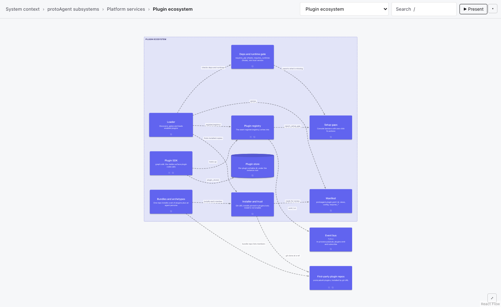
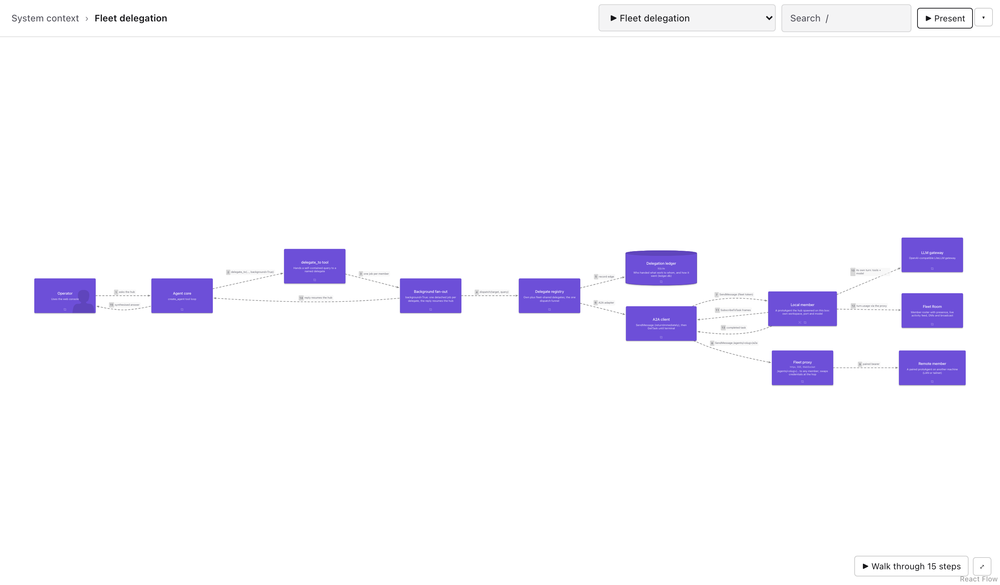
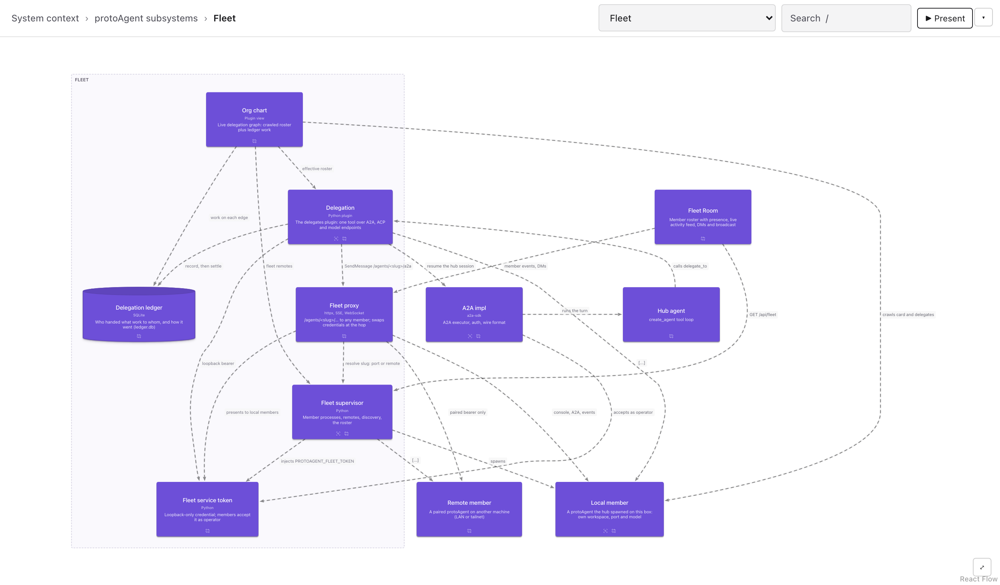

# protoAgent architecture model

A [LikeC4](https://likec4.dev) model of protoAgent itself, written for the
[Atlas plugin](https://github.com/protoLabsAI/atlas-plugin): drill-down views from the system
context down to components, step-by-step flows, and presenter tours. It covers the whole runtime
at the top levels and goes deep on the **plugin ecosystem and the plugin SDK** and on the **fleet**:
a hub agent delegating to its members over A2A.

Every element links to the code that defines it (`link /src/...#Lnn`, project-root relative, so the
links open in the console's code pane). Where an ADR governs an element, it is in `metadata { adr }`.

| File | Holds |
|---|---|
| `likec4.config.json` | The project config (JSON only; Atlas reads no `.ts` config) |
| `spec.c4` | Element kinds and tags |
| `model.c4` | System context, the three subsystems, containers, core components |
| `plugins.c4` | The plugin ecosystem, what a plugin contributes, the plugin SDK, the console view bridge, first-party plugin repos |
| `fleet.c4` | The fleet: supervisor, proxy, fleet token, delegation, ledger, org chart; the A2A layer; local and remote members; the Fleet Room |
| `views.c4` | Every view and the flows (`chat_turn_flow`, `plugin_lifecycle`, `sdk_tool_call`, `fleet_delegation`) |
| `atlas.tours.json` | Tours: `overview`, `plugins` and `fleet` |

**Views:** System context → protoAgent subsystems → Interfaces / Agent core / Platform services →
Console, Server, Agent graph, **Plugin ecosystem** → **What a plugin contributes**, **Plugin SDK**,
**Console to plugin view bridge**, First-party plugin repos. The fleet: protoAgent subsystems →
**Fleet** → **Fleet supervisor**, **Delegation**; Interfaces → **A2A layer**; System context →
**A fleet member**.



## The fleet

The hub is the protoAgent you talk to; its members are other protoAgents. The **supervisor** spawns
local members (each with the loopback-only **fleet token** in its env) and pairs remote ones for a
revocable token of their own (ADR 0113). The **fleet proxy** (`/agents/<slug>/…`) reaches any member
and swaps the fleet token for a remote's paired token at the hop, so that token never leaves the hub.
`delegate_to` dispatches through the delegate registry, which records every edge in the **delegation
ledger**; the **org chart** draws the roster with the ledger's work on each edge.

`fleet_delegation` follows one fan-out: `delegate_to(background=True)` per member, a local and a
remote member reached in parallel, the hub following each task live over `SubscribeToTask` (narration
and tools, never the answer early), the Fleet Room logging each member's finished turn, and every
reply resuming the hub to synthesise. Run it with `tour="fleet"`.





## Viewing it

Install the Atlas plugin and open its rail view. Atlas reads `architecture/` from the project root by
default (its `model_dir` setting), so there's nothing to configure. Ask the agent to walk you through
it: Atlas gives the agent tools to move the view, highlight elements, step through a flow, and run a
tour (`tour="plugins"`).

Without a console, the Atlas repo's dev server renders the model:

```bash
cd atlas-plugin/web && npm ci && npm run build:view
node dev/server.mjs --model /path/to/protoAgent/architecture --project-root /path/to/protoAgent
# http://localhost:4720/plugins/atlas/view#view=plugin_lifecycle
```

## Validating it

```bash
node atlas-plugin/vendor/atlas-engine.mjs validate architecture   # {"ok":true,...}
```

That runs LikeC4's checks only. The agent's `atlas_validate` tool also runs Atlas's lint: no view
over 12 nodes, a scoped view for every parent, code links that resolve, no sequence-view nesting,
and sound tours. Keep it at `Engine: OK` / `Lint: clean`. The rules are in Atlas's
[authoring guide](https://github.com/protoLabsAI/atlas-plugin/blob/main/docs/authoring.md).

When code moves, the code links move with it: a renamed file fails `code-link-missing`. Line
anchors (`#Lnn`) aren't checked, so re-point them when you change the file they point into.
